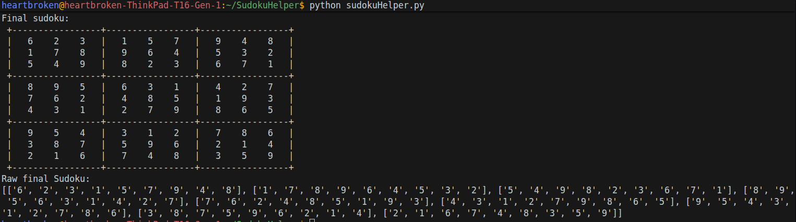

# 🧩 Sudoku Solver Assistant (Human-like Strategy)



This Python script is a human-style Sudoku solving assistant. It takes a Sudoku puzzle input (row by row) and attempts to reduce possibilities for each cell using logical deductions — mimicking how a person might approach solving a puzzle step by step.

## 📋 Features

- Input Sudoku manually via console (as 9 lines of 9 characters each)
- Displays the Sudoku board before and after each solving phase
- Performs constraint-based elimination:
  - ✅ Row checking
  - ✅ Column checking
  - ✅ Box (3×3 subgrid) checking
- Iterates through these checks until no more progress is made
- Final output is a cleaned-up grid with only solved digits shown
- Includes nicely formatted display output for better visualization

## 🔧 How It Works

The script follows a simple rule-based logic:

1. **Row Checking**: For each empty cell, eliminate numbers already present in the same row.
2. **Column Checking**: Further reduce candidates based on the column.
3. **Box Checking**: Finally, reduce based on the 3×3 subgrid.
4. Repeat the above checks in a loop until the board state no longer changes.
5. **Hint Remover**: All remaining multi-digit candidates are removed for a clean final display.

> It doesn’t use any brute-force or backtracking — just pure logical deductions like a human might attempt.

## ✅ Example

```bash
Enter 1st row of Sudoku (no gaps between numbers!):53  7
Enter 2nd row of Sudoku (no gaps between numbers!):6  195
Enter 3rd row of Sudoku (no gaps between numbers!): 98    6
...
```

Intermediate states will be printed, ending with something like:

```
Final sudoku:
 +-----------------+-----------------+-----------------+
 |  5   .   3  |  .   7   .  |  .   .   .  |
 |  6   .   .  |  1   9   5  |  .   .   .  |
 |  .   9   8  |  .   .   .  |  .   6   .  |
...
```

## 🧪 Testing

The script includes several commented-out test puzzles taken from newspapers, Sudoku magazines, and Wikipedia. Just uncomment any of them to use instead of live input. (And set DEBUG to True instead of false)

## 🛠️ Requirements

- Python 3.x
- No external libraries needed (uses only `copy` for deep copying)

## 🗂️ File Structure

- `sudokuHelper.py` — main script file
- `README.md` — this file
- `Screenshot.png` — a screenshot of the end result of this program

## 🚀 Future Improvements

- Implement logical strategies like:
  - Naked/hidden singles/pairs
  - Pointing pairs/triples
  - X-Wing/Swordfish
- Optional GUI for better interaction
- Web or mobile interface

## 📜 License

No.
